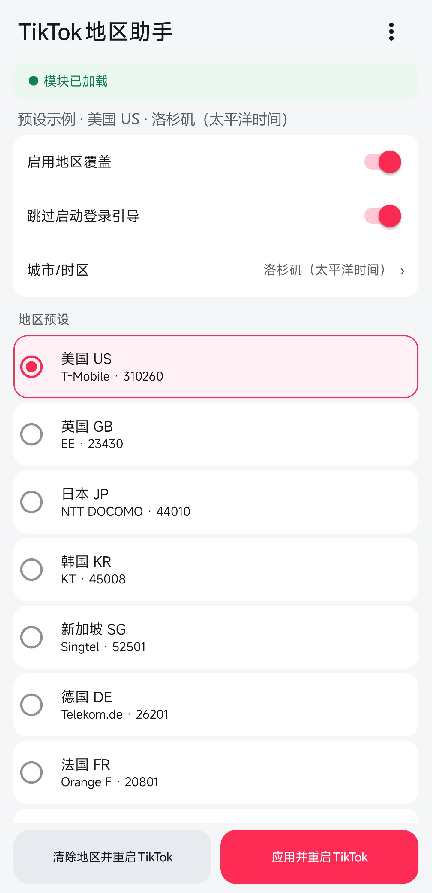
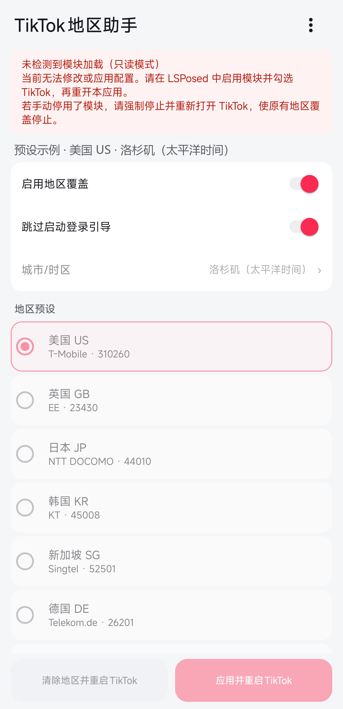

# TikTok地区助手

简体中文 | [English](README_EN.md)

一个仅作用于 TikTok 进程的 LSPosed 模块，用于统一 TikTok 读取到的地区、SIM、运营商、时区和商店地区信号。

当前版本：`1.6.0`

## 1.6.0 更新

- 适配 Google Play TikTok 47.7.3 的商店地区接口；保留旧版 Hook 分支，并跳过返回类型不匹配的内部方法。
- 重新设计紧凑设置页，更新中文名称和环球定位图标。设置项整行可点击，设置与地区列表统一滚动，底部两个操作按钮固定并排。
- 底部按钮随文字换行自适应高度，最小触摸高度 48dp；已检查 320dp 宽度下 100%、130%、200% 字号的完整显示和列表滚动。
- 城市/时区使用独立选择框，避免展开后挤占地区列表。
- 新增模块加载提示和只读模式；未检测到加载时禁止修改和应用配置。手动停用模块后需强制停止并重新打开 TikTok，才能停止原进程中的地区覆盖。
- 修复桌面启动误触地区、选择城市后首次操作无响应，以及从关于页返回时国家、城市与配置摘要不一致的问题。
- 区分“待应用”和“已保存”；首次安装的默认预设不再误标为已保存。关于页同步显示最新已测 TikTok 版本及验证范围。

## 界面预览

以下截图展示模块加载状态的区别，已裁除系统状态栏和导航栏，并将配置摘要匿名化为公开预设示例。

| 模块已加载 | 模块未加载（只读模式） |
| :---: | :---: |
|  |  |
| 可编辑地区和城市，点击“应用并重启TikTok”后应用配置。模块加载状态不等同于地区覆盖开关状态。 | 配置不可修改或应用。若手动停用了模块，需强制停止并重新打开 TikTok，使原有地区覆盖停止。 |

## 功能

- 支持美国、英国、日本、韩国、新加坡、德国、法国、加拿大和澳大利亚预设。
- 可在国家预设内选择常用城市/时区，例如美国的洛杉矶、纽约、芝加哥和丹佛。
- 同步覆盖 country ISO、MCC/MNC、运营商、SIM、系统地区和商店地区等地区信号。
- 支持 `com.zhiliaoapp.musically` 和 `com.ss.android.ugc.trill` 两种 TikTok 包名。
- 在 LSPosed 作用域页面将已安装的 TikTok 标记为“推荐应用”并置顶。
- 可选择跳过 TikTok 冷启动时可关闭的登录引导。
- “应用并重启 TikTok”会保存地区、强制停止 TikTok 并重新打开。
- “清除地区并重启 TikTok”会停用全部地区覆盖，恢复使用真实 SIM 和系统地区。
- 配置会缓存到 TikTok 进程可读取的位置，TikTok地区助手无需常驻后台。
- 设置页右上角提供关于入口，可查看模块版本、已验证的最新 TikTok 版本、源代码、反馈和许可证。

## 兼容性

最新已测版本为 **Google Play 47.7.3**。开发验证覆盖信息流、评论、用户主页与作品列表、US/JP 配置保存及冷启动、模块非驻留和清除地区；模块停用、US/JP 覆盖、模块启用但关闭覆盖四组分别连续上滑 7 条，均观察到后续加载和画面变化。

手机号前缀、国外 SIM 恢复及完整交互矩阵未全部验证，连续播放可用不证明推荐内容的地域归属；最终构建未重跑完整播放矩阵。

| 项目 | 状态 |
| --- | --- |
| 最新已测 TikTok 版本 | Google Play 47.7.3（验证范围见上） |
| 当前模块对旧版的回归状态 | 保留旧 Hook 分支，尚未逐版本重新回归 |
| 历史已验证 TikTok 版本 | Google Play 46.1.3、46.5.3、46.6.3（使用当时的模块版本） |
| 已验证包名 | `com.zhiliaoapp.musically`、`com.ss.android.ugc.trill` |
| 已验证 Android 版本 | Android 12、Android 16 |
| 最低 Android 版本 | Android 8.1（API 27） |
| 运行环境 | Root + LSPosed/Vector |

模块同时 Hook Android 稳定 Telephony API 和 TikTok 内部地区提供器。TikTok 的内部混淆类可能随版本变化；升级 TikTok 后如果功能异常，需要针对新版本重新适配。

## 安装

1. 确认设备已具备可用的 Root 和 LSPosed/Vector 环境。
2. 从 [Releases](https://github.com/kjqg-cn/tiktok-region-hook/releases) 下载并安装 TikTok地区助手 APK。
3. 在 LSPosed 中启用模块，确认已安装的 TikTok 显示为“推荐应用”且已勾选。
4. 打开 TikTok地区助手，选择地区后点击“应用并重启TikTok”。
5. KernelSU/Magisk 首次询问 Root 权限时选择长期允许，否则应用无法强制停止 TikTok。

更新模块后，确认 TikTok 仍在作用域内并已启用，然后强制停止并重新打开 TikTok 即可加载新 Hook；通常不需要重新优化模块。“重新优化”属于 ART dex/profile 优化，仅在目标进程重启后仍疑似未加载新模块时作为排查手段。覆盖安装通常会保留 Root 授权；卸载重装会清除授权，需要重新授予。

## 使用

### 切换地区

选择一个地区预设和对应的城市/时区，保持“启用地区覆盖”开启，然后点击“应用并重启 TikTok”。地区变化必须在 TikTok 进程完全重启后才能稳定生效。

### 恢复真实 SIM 地区

插入目标国家或地区的 SIM 卡时，可以点击“清除地区并重启 TikTok”。模块会写入停用状态并重启 TikTok，不会删除 TikTok 数据；上次选择的预设仍会保留，但不会生效。

### 跳过启动登录引导

该选项只处理 TikTok 新进程启动后短时间内可关闭的登录引导，不会绕过账号登录、验证或其他访问限制。

## 权限与安全

- Root 仅用于执行 TikTok 的 `am force-stop` 和显式 Activity 启动。
- 模块不修改系统地区、系统属性、方向锁定或其他全局设置。
- 地区 Hook 仅安装在受支持的 TikTok 进程中。
- 模块不包含网络权限，不上传配置或设备信息。
- 本项目不会修改或重签 TikTok APK。

## 已知限制

- 本模块不能替代可用的国际网络环境；TikTok 服务端仍会结合 IP、账号和其他风控信号判断可用性。
- TikTok 更新可能改变内部混淆类，使部分版本专用 Hook 失效。
- 信息流能够加载不代表登录、用户主页和所有地区接口都一定兼容，应在更新 TikTok 后完整回归。
- 点赞、关注等交互受平台多种条件影响；地区覆盖通过不代表交互持久性已完整验证，不能据此判断模块是相关问题的原因。
- 该方案依赖 Root 和 LSPosed，不适用于未 Root 设备。

## 从源码构建

要求：

- JDK 21
- Android SDK，包含 API 34
- 项目自带的 Gradle Wrapper

调试构建：

```powershell
.\gradlew.bat clean lintDebug assembleDebug
```

Linux/macOS：

```bash
./gradlew clean lintDebug assembleDebug
```

发布构建需要本地 `keystore.properties`。复制 `keystore.properties.example`，填写自己的签名库信息；不要提交签名库、密码或 `keystore.properties`。

```powershell
.\gradlew.bat clean lintRelease assembleRelease
```

维护现有发行签名时，必须继续使用相同证书，否则无法覆盖安装旧版本。发布 APK 应上传到 [Releases](https://github.com/kjqg-cn/tiktok-region-hook/releases)，不建议提交到 Git 仓库。

## 项目结构

```text
app/src/main/java/com/local/tiktokregion/  模块与配置源码
app/src/main/resources/META-INF/xposed/    Xposed 作用域元数据
app/src/main/res/                          Android 资源
app/libs/api-82.jar                        Xposed API 编译依赖
AGENTS.md                                  版本适配与真机验收流程
```

维护者在适配新 TikTok 版本前应先阅读 [AGENTS.md](AGENTS.md)。

## 许可证

本项目基于 [Apache License 2.0](LICENSE) 发布，版权所有 (c) 2026 [kjqg-cn](https://github.com/kjqg-cn)。第三方组件遵循其各自许可证，详见 [THIRD_PARTY_NOTICES.md](THIRD_PARTY_NOTICES.md)。

## 免责声明

本项目是独立的开源研究与设备自定义工具，与 TikTok、ByteDance、LSPosed、Vector、KernelSU、Magisk 及其关联方不存在隶属、合作、授权、认可或赞助关系。TikTok 及相关名称、商标和标识归其各自权利人所有。

本项目不包含、不分发、不修改也不重签 TikTok APK，不提供 TikTok 专有代码、账号、网络代理或地区服务。项目仅在用户自行安装的受支持 TikTok 进程中调整部分本地运行时返回值。

使用者应确保其对设备、软件和账号具有合法管理权限，并自行遵守所在国家或地区的法律法规、TikTok 服务条款、社区规范及其他适用协议。本项目无意用于绕过付费机制、账号验证、访问控制、安全措施、制裁限制，或实施任何未经授权的访问。当地法律或适用协议禁止时，请勿使用。

Root、LSPosed 和运行时 Hook 可能导致应用异常、设备不稳定、数据丢失、隐私或安全风险，也可能触发平台风控、功能限制、账号暂停或封禁。使用前请自行备份重要数据，并理解相关技术和账号风险。

本软件按“原样”提供，不对可用性、适销性、特定用途适用性、不侵权性、持续兼容性、地区访问能力或账号安全作任何明示或默示保证。TikTok 更新、服务端策略、网络环境或设备差异均可能导致本项目部分或全部失效。

在适用法律允许的最大范围内，项目维护者和贡献者不对因使用、无法使用、错误配置或分发本项目所产生的任何直接、间接、附带、特殊、惩罚性或后果性损失承担责任，包括但不限于数据丢失、设备故障、账号受限、业务中断或利润损失。本免责声明不排除或限制依法不得排除或限制的责任。

下载、安装、修改、分发或使用本项目，即表示使用者已理解并自行承担相关风险。
